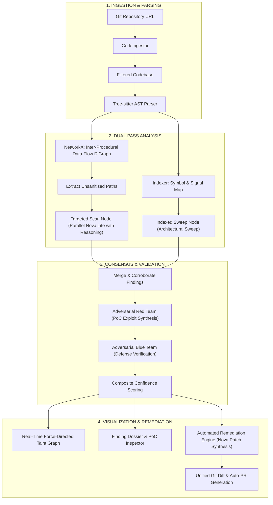

<div align="center">

# 🛡️ NovaSecurity (NovaGuard)

**Next-Generation AI-Native SAST & Automated Vulnerability Remediation Platform**

*Combining Compiler-Level AST Data-Flow Taint Analysis with Adversarial Multi-Agent Reasoning on Amazon Nova.*

[](https://www.python.org/)
[](https://nextjs.org/)
[](https://fastapi.tiangolo.com/)
[](https://langchain-ai.github.io/langgraph/)
[](https://aws.amazon.com/ai/generative-ai/nova/)
[](LICENSE)

</div>

---

## 🌟 Executive Summary

Traditional Static Application Security Testing (SAST) tools suffer from two extremes: rule-based engines flood developers with false positives, while naive LLM scanners hallucinate vulnerabilities without understanding data flow.

**NovaSecurity** solves this by uniting **compiler-grade AST taint analysis** with an **adversarial multi-agent LangGraph pipeline** powered by **Amazon Nova (`nova-2-lite-v1`)**:
1. **Precise Taint Tracking**: Tree-sitter and NetworkX trace actual data flows from untrusted user inputs (sources) to dangerous execution points (sinks), identifying missing sanitization paths.
2. **Dual-Scan Coverage**: Targeted path-level reasoning is coupled with an architectural sweep across high-priority configuration and route handlers.
3. **Adversarial Red/Blue Team Validation**: Every Critical/High finding undergoes an automated debate where an offensive agent constructs a functional Proof-of-Concept (PoC) exploit, and a defensive agent attempts to refute it using existing guards.
4. **Automated Surgical Remediation**: Confirmed vulnerabilities are automatically patched in isolated git branches, producing unified diffs and one-click GitHub Pull Requests.

---

## 🏗️ System Architecture



---

## 🔬 Core Capabilities

### 1. AST Data-Flow Taint Analysis
- Leverages `tree-sitter-python` to extract function declarations, decorators, classes, imports, and variables.
- Builds an inter-procedural directed graph (`networkx.DiGraph`) modeling:
  - **Sources**: `request.args`, `request.json`, `request.form`, `sys.argv`, `os.environ`, `input()`.
  - **Intermediates**: Variable assignments, attribute lookups, method calls.
  - **Sanitizers**: `escape()`, `bleach.clean()`, `shlex.quote()`, `parameterize()`.
  - **Sinks**: `cursor.execute()`, `os.system()`, `subprocess.Popen()`, `eval()`, `render_template_string()`, `open()`.

### 2. Adversarial Red / Blue Validation Formula
To eliminate false alarms, each finding is subjected to adversarial multi-agent debate. The final confidence is evaluated according to:

$$\text{Final Confidence} = 0.30 \cdot C_{\text{LLM}} + 0.25 \cdot S_{\text{Graph}} + 0.25 \cdot E_{\text{Red}} + 0.20 \cdot (1.0 - D_{\text{Blue}})$$

| Variable | Weight | Description |
|---|---|---|
| $C_{\text{LLM}}$ | 30% | Base confidence score assigned by initial scan passes |
| $S_{\text{Graph}}$ | 25% | 1.0 if corroborated by AST source-to-sink flow; 0.0 otherwise |
| $E_{\text{Red}}$ | 25% | 1.0 if the Red Team generated an exploit PoC; 0.0 otherwise |
| $D_{\text{Blue}}$ | 20% | 1.0 if the Blue Team verified defense or framework mitigations |

- **Confirmed** ($\ge 0.60$): Proven exploitable vulnerabilities with high confidence.
- **Needs Review** ($0.30 - 0.59$): Suspected flaws requiring human triage.
- **Likely False Positive** ($< 0.30$): Disputed or unexploitable detections (filtered automatically).

### 3. Automated One-Click Remediation
- Creates an isolated Git worktree branch (`nova/<vulnerability-slug>-<fix_id>`).
- Assembles full-file context with surrounding call sites.
- Prompts Amazon Nova to synthesize minimal, non-breaking security patches.
- Commits changes to the branch and produces side-by-side unified diffs.
- Pushes to remote and opens a GitHub Pull Request with structured descriptions and test recommendations.

---

## 📂 Repository Layout

```
NovaSecurity/
├── backend/                        # FastAPI & LangGraph analysis engine
│   ├── prompts/                    # Carefully tuned LLM prompts
│   │   ├── targeted_scan.txt       # Single-path taint verification
│   │   ├── targeted_scan_batch.txt # Batched path evaluation
│   │   ├── indexed_scan.txt        # Architecture & config sweep
│   │   ├── red_team.txt            # Exploit generation prompt
│   │   ├── blue_team.txt           # Defense verification prompt
│   │   └── fix_vulnerability.txt   # Surgical patch generation
│   ├── demo_results/               # Benchmark scan fixtures (lets-be-bad-guys, vulpy)
│   ├── agent.py                    # LangGraph multi-agent workflow
│   ├── api.py                      # FastAPI REST & SSE endpoints
│   ├── graph.py                    # Tree-sitter AST data-flow graph builder
│   ├── indexer.py                  # Codebase indexing & signal classification
│   ├── ingestor.py                 # Git repository cloning & filtering
│   ├── main.py                     # Entry point for backend server
│   ├── nova.py                     # Amazon Nova LLM interface with reasoning
│   ├── remediation.py              # Automated patch synthesis & Git branch manager
│   ├── storage.py                  # Optional Supabase persistence
│   ├── pyproject.toml              # Python project metadata
│   ├── requirements.txt            # Python dependencies
│   └── .env.example                # Backend configuration template
│
├── frontend/                       # Next.js 16 Cyberpunk Dashboard
│   ├── app/
│   │   ├── components/
│   │   │   ├── report/             # ReportView, FindingCard, DiffViewer
│   │   │   ├── scan/               # ScanningSequence, ScanningBackdrop
│   │   │   └── ui/                 # Hero, Modal dialog
│   │   ├── hooks/                  # useScan, useFixes custom hooks
│   │   ├── lib/                    # API client and TypeScript definitions
│   │   ├── globals.css             # Tailwind v4 styles
│   │   ├── layout.tsx              # Root HTML layout
│   │   └── page.tsx                # Main view state controller
│   ├── public/                     # Static assets & demo datasets
│   ├── package.json                # Frontend dependencies
│   ├── tsconfig.json               # TypeScript configuration
│   └── .env.example                # Frontend configuration template
│
├── .gitignore                      # Monorepo ignore rules
├── LICENSE                         # MIT License
└── README.md                       # Project documentation
```

---

## ⚡ Quickstart Guide

### 1. Prerequisites
- **Python 3.10+**
- **Node.js 20+** or **Bun**
- **Git CLI**

---

### 2. Backend Setup

```bash
# Navigate to backend
cd backend

# Create and activate virtual environment
python3 -m venv .venv
source .venv/bin/activate       # On Windows: .venv\Scripts\activate

# Install dependencies
pip install -r requirements.txt

# Configure environment variables
cp .env.example .env
```

Edit `.env` to configure your API keys (optional if running in demo mode):
```env
NOVA_API_KEY=your_amazon_nova_api_key
NOVA_BASE_URL=https://api.nova.amazon.com/v1
NOVA_MODEL=nova-2-lite-v1
```

Start the backend server:
```bash
python main.py
# API runs on http://127.0.0.1:8000
# OpenAPI Docs: http://127.0.0.1:8000/docs
```

---

### 3. Frontend Setup

In a separate terminal:
```bash
# Navigate to frontend
cd frontend

# Install dependencies
bun install
# or: npm install

# Configure environment variables
cp .env.example .env.local

# Start the Next.js development server
bun dev
# or: npm run dev
```

Open your browser to [http://localhost:3000](http://localhost:3000).

---

## 🎮 Running a Scan

### Instant Demo Mode (Zero Credentials Required)
Click either of the pre-loaded demo repository buttons in the UI:
- **`lets-be-bad-guys`**: A vulnerable Flask application showcasing SQL injection, Command Injection, and Path Traversal.
- **`vulpy`**: A comprehensive vulnerable Python security benchmark.

Demo scans simulate the complete 8-step pipeline with real-time SSE progress, rendering the full interactive graph and finding cards.

### Live Repository Scan
Enter any public Git URL into the input field:
```
https://github.com/octocat/Hello-World
```
NovaSecurity will clone the repository, build the AST data-flow graph, invoke Nova agents in parallel, and deliver validated findings within seconds.

---

## 🛠️ Technology Stack

| Layer | Technology | Purpose |
|---|---|---|
| **AI / LLM** | Amazon Nova (`nova-2-lite-v1`) | Deep security reasoning, PoC exploit generation, code remediation |
| **Agent Workflow** | LangGraph | State machine orchestration for 8-phase pipeline |
| **AST Parsing** | Tree-sitter (`tree-sitter-python`) | High-speed grammar querying and symbol extraction |
| **Graph Analysis**| NetworkX | Inter-procedural directed data-flow and taint path detection |
| **Backend API** | FastAPI + Uvicorn | Async REST API and Server-Sent Events (SSE) streaming |
| **Frontend** | Next.js 16 + React 19 | Responsive App Router dashboard |
| **UI & Styling** | Tailwind CSS v4 + Framer Motion | High-performance cyberpunk dark mode UI and animations |
| **Icons** | Lucide React | Cyber/security visual icon system |
| **Database** | Supabase (Optional) | Persistent scan records and finding histories |

---

## 📄 License

This project is licensed under the [MIT License](LICENSE).
