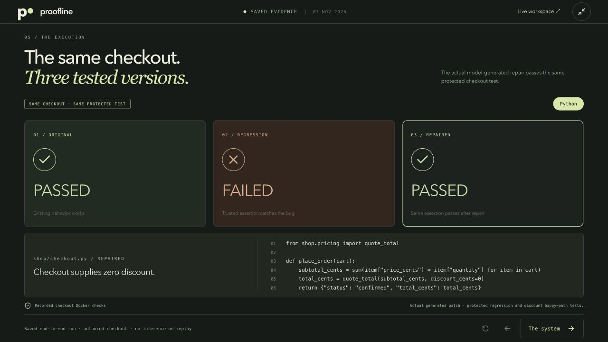

# Proofline — AI Code Review

**Neural Storm 2026 · Future Tech · FT-05**

Proofline helps developers reviewing Python, JavaScript and TypeScript changes catch cross-file regressions and inspect the evidence behind proposed fixes. A small change can break an unchanged caller; a confident AI comment can still be wrong. Proofline connects the diff to callers, deterministic checks, source quotations and approved repair tests.

Python orchestration combines static analysis with Gemini API or local Codex review, bounded investigation, a separate assessment pass, and controlled execution. Model assessments and executed tests are reported as different kinds of evidence.



Actual saved checkout run: AI review, a model-generated caller repair, and the same protected Docker test passing on the original and repaired versions and failing on the changed version. Replay the six-scene walkthrough at `/showcase`; use `/review` for a live run.

## Results at a glance

| Validation | Observed result | What it establishes |
|---|---|---|
| Backend regression suite | 181 passed, one opt-in Docker test skipped | Implementation behavior, not AI accuracy |
| Standard frontend lint | Passed after generated-build exclusions | Normal lint command works |
| Static smoke evaluation | 5 TP / 5 TN on ten selected cases | Selected static rules only |
| Frozen 24-case comparison | Static: 2/12 original targets; diff-only AI: 12/12; full: 10/12, six partial runs | Small authored dataset; AI-assisted builder adjudication |
| Real Codex integration | Four-invocation review and assessment completed on an authored fixture | Working provider and review workflow |
| Docker verification | Recorded Python / JS / TS base-pass, changed-fail, patched-pass checks | Prepared contract environments |
| Subsequent recovery | Six quota cases completed; separate dictionary validator-fix retest passed | Known-case retries, not replacement heldout scores |
| Label evidence | AI-assisted source review completed at user request; original human export retained | Not independent human validation |
| Explicit authored contracts | 48 checks produced expected baseline/change outcomes | Fixed inspected snippets, not arbitrary repos |
| Developer benefit | No volunteer study available | No time-saving claim |

[Detailed comparison, noise and limitations](docs/audit-results.md) · [Audit fixes and remaining evidence](docs/audit-closure.md) · [Evaluation protocol](evals/README.md). Full raw reports remain available; incomplete results are not relabeled successful.

[Animated hackathon film](videos/proofline-commercial/proofline-hackathon-music.mp4) · [Narration script](videos/proofline-commercial/NARRATION.md) · [Submission package](docs/submission-package.md)

The 100-second film combines original motion graphics with actual recorded checkout evidence. It includes a quiet, credited music bed; add your narration before uploading. [Music credit and upload description](videos/proofline-commercial/UPLOAD-DESCRIPTION.md).

## Working workflow

Use **Paste a link**, **Pick from GitHub**, or **Local folder**. Repository, branch, PR, commit and comparison URLs are detected automatically. Review settings expose revision and quick/deep scope; debug settings expose model roles, Gemini API mode, reasoning and attempt limits. **Try checkout demo** builds a real pricing-refactor regression with a Python caller and an approved checkout verification profile. Inspect prioritized findings, source, independent quotations, diffs, change impact and coverage; propose/download repairs or use configured verification/publication controls. [Review scopes and CLI usage](docs/review-modes.md).

The primary interface is `/` (also `/review`). Supported analysis is described precisely in [the language matrix](docs/language-support.md):

- Python: Ruff E/F/B checks, Bandit, qualified context, explicit changed-signature caller checks.
- JavaScript/JSX and TypeScript/TSX: trusted compiler parsing, syntax diagnostics, selected rules, compiler-resolved snapshot-local calls and compatibility checks. TypeScript also has selected virtual-project semantic diagnostics.
- All three: source-context Gemini review when configured. No reviewed code/configuration executes during analysis.
- Verification: approved operator-owned Python, JavaScript and TypeScript contract profiles using isolated Docker workers. These fixture environments do not establish arbitrary-project compatibility or full framework type checking.

## Run locally

Prerequisites: Python 3.12+ with Git, Node 20+ and npm. Install Python and frontend dependencies, since the Python backend uses Node's trusted TypeScript parser.

```sh
make setup
cp .env.example .env
make dev
# in another terminal:
cd frontend
npm run dev
```

Open http://localhost:3000. Without a configured key/model, static findings still work and model analysis is explicitly incomplete. Set `GEMINI_API_KEY` and `PROOFLINE_GEMINI_REVIEW_MODEL` server-side for live contextual review; choose an available text model supporting structured output. No valid model ID or quota is assumed.

Remote operator deployment requires `PROOFLINE_OPERATOR_TOKEN`; enter it in connection settings. See [deployment and recovery](docs/deployment.md). Public deployment/video links and team/member names must be filled with actual values before submission; none are invented here.

## Validate

```sh
make test
make lint
make build
make eval
```

The ten-case development pipeline evaluation produced TP=5, FP=0, TN=5, FN=0 for specific supported static rules. This is a small integration dataset, **not production accuracy**. It runs the actual engine with unavailable model inference explicitly reported. See [evaluation scope](docs/evaluation.md). Native Gemini and GitHub API contracts have network-free test coverage; live provider/publication still need testing with authorized credentials.

The isolated execution integration test requires a running Docker daemon, enabled execution and a prebuilt digest-pinned test image. Infrastructure errors never count as a verified repair. Ordinary regression tests and structured result parsing are checked independently.

## Architecture and stack

Python/FastAPI, Pydantic, SQLite WAL, GitPython, Python AST indexing, NetworkX, Ruff, Bandit, Google GenAI SDK; Next.js/React/TypeScript frontend. Review stages cover immutable ingestion, static/language checks, contextual assessment, challenge, citation validation and deduplication. A two-slot scheduler bounds local review concurrency. Persisted reports survive restarts; incomplete jobs become interrupted.

Patches are validated against cited files and exact unique old content. Publishing is a separate explicit action; it never merges. Docker verification runs on a disposable copy with operator tests mounted read-only and resource/network restrictions. The model cannot choose host commands.

[Language support](docs/language-support.md) · [Deployment](docs/deployment.md) · [Evaluation](docs/evaluation.md) · [Demo guide](docs/demo-script.md) · [Implementation status](docs/implementation-status.md)

## Limitations and disclosure

This is a single-operator application, not a completed multi-tenant hosted service. Dynamic call resolution, inferred return-shape compatibility, general taint analysis, full framework/dependency type coverage and external benchmark generalization are outside the measured scope. Test-gap questions are retrieval hints, not coverage measurements. Automated advice and proposed patches need human review.

AI tools used: Codex for implementation/review assistance; Gemini API for configured live contextual review and patch proposals. Third-party analyzers retain their own rule provenance; their contribution is distinguished from Proofline's context, compatibility, orchestration and workflow code. Preserve existing MIT license and upstream attribution.

### GitHub repository picker

Choose **Pick from GitHub** to connect and select a repository, branch, PR or commit. Or use **Paste a link** for automatic scope detection. Local folders and analysis depth live under secondary disclosures. [Configure the GitHub App](docs/github-connection.md). The connection follows the existing single-operator deployment model.

## Advanced runtime and evidence

Read-only tool investigation and independent batched verification use shared budgets and explicit source provenance. API/CLI resume uses sealed source and matching checkpoints. [Phase completion audit](docs/completion-audit.md) distinguishes implemented capabilities, real Docker evidence, partial live Gemini results, and remaining independent evaluation/integration gates. [Operator verification](docs/operator-verification.md) · [Evaluation protocol and blinded packet](evals/README.md).

## Local ChatGPT subscription demo

Proofline also supports native Codex CLI with ChatGPT sign-in on localhost. The local demo is configured for the account-discovered default model with high reasoning. Choose **Settings & debug → Model provider → Local Codex · ChatGPT subscription**. Leave Model ID blank for the discovered default, or select an available model. Review, verification and repairs use the same provider. See [local Codex setup and actual results](docs/local-codex.md). Requests go to OpenAI and consume subscription limits; this is not offline inference or an unlimited API.
