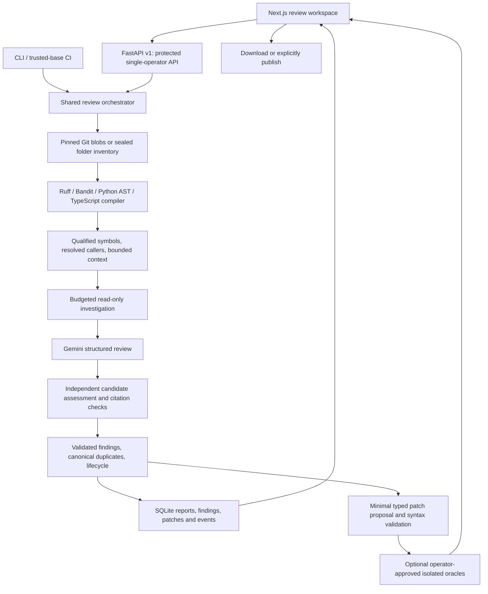

# Proofline architecture

Proofline reviews Python, JavaScript and TypeScript projects or changes. It combines deterministic observations, bounded source investigation and independent model assessments; approved test execution is a separate step. This document describes current code. [The phase audit](completion-audit.md) lists unverified acceptance gates.

## Source and scope

The URL parser supports GitHub repositories, branches, PRs, commits and comparisons. Local folders and CLI working-tree changes use the same review engine. Revisions are resolved to immutable SHAs; PR analysis uses the appropriate merge base and pinned fork head. Git source extraction reads regular blobs without executing checkout hooks, project configuration, submodules or symlink targets.

Known credential paths, private-key extensions and configured output/database locations are excluded before local copying or snapshot analysis. Credential templates remain allowed. Local projects containing their own review output cannot recursively copy it. Exclusions and reasons are visible under coverage. These defaults are not a complete secret detector; cloned Git object databases may still contain repository history.

Each review has a UUID workspace. Base/head inventories, diff, scope and configuration are sealed with a digest. Resume creates a new run against that source rather than fetching the latest revision. Matching source/config/schema/tool-version checkpoints can avoid repeating analysis or model requests. Digests detect corruption; they are not signatures against a malicious trusted operator.

## Deterministic analysis and repository context

Python uses operator-controlled Ruff E/F/B and Bandit (repository config and suppression comments cannot silently disable checks), Python AST qualified symbols, selected resolved call edges and required-argument compatibility checks. JS/TS uses the trusted installed TypeScript compiler through a bounded Node subprocess: syntax diagnostics, selected rules, virtual-project references and selected TypeScript semantic checks. Snapshot-local aliases, re-exports, default/namespace imports and included declarations are supported within the documented limits.

The code map includes changed/deleted declarations, known callers and test hints. Unresolved or lexical relationships remain hints. This is not a whole-program taint engine. Tree-sitter and Semgrep are not active stages. [The capability matrix](language-support.md) describes language differences.

## Model runtime and evidence

RunConfig records model roles, API mode, thinking level, strategy, attempt/model/tool limits and deadline. Native Gemini Interactions and generateContent share explicit retries, quota scheduling and measured request activity. Automatic SDK transport retries are disabled. Interactions additionally disables conversation storage and automatic continuation. Incomplete or invalid JSON never counts as a successful response. Returned usage is recorded, including incomplete outputs; token usage missing from provider errors is unknown.

The harness exposes six typed read-only tools over the sealed inventory: source ranges, literal search, symbols, references, diffs and related tests. Observations carry snapshot hashes. Project review receives the retrieved observations. Request, tool, budget and checkpoint events are validated; start/completion/cache events share request identities. No hidden chain of thought is shown.

Independent verification prioritizes candidates and uses separate bounded investigation and batches. It validates exact source quotations and records assessed/unassessed candidates. Evidence outcomes are source-supported, refuted or insufficient. Model disagreement cannot erase deterministic observations. Explicit rule aliases may merge a duplicate static/model signal while retaining both provenances; speculative fuzzy merges are avoided. Source support never implies execution proof.

## Repair and behavioral execution

Patch proposals modify the cited source file through exact unique replacements. No-op, stale, escaping and protected-file edits are rejected. Python syntax uses AST parsing; JS/JSX/TS/TSX syntax uses the trusted compiler parser without running source. Worker logs are captured with a memory/output cap, container file writes have a size cap, result directories are private and DTD/entity declarations are rejected from test reports. Passing syntax leaves the patch **proposed**, not behaviorally verified.

Optional execution requires an operator-owned profile and digest-pinned Docker image. Source and independent tests are mounted read-only, with no network, non-root identity and constrained resources. Differential profiles require a passing base, the designated regression assertion failing on head while unrelated tests pass, and all checks passing after repair. The original source remains unchanged. Missing tests/dependencies, unexpected failures and incomplete reports are inconclusive. [Verification protocol](verification.md).

## Persistence, cancellation and recovery

SQLite WAL stores runs, findings, patches and monotonic events. Two in-process slots bound review concurrency. Cancelled queued jobs do not initialize a provider; stale worker saves preserve cancellation. Restart marks orphaned queued/running records interrupted, records a terminal event and preserves completed reports.

The browser uses one review-session reducer with aborted stale requests and generation checks. It polls saved snapshots, retries transient reads with bounded backoff, follows active saved reviews and restores `?run=...` on reload. Reconnect never submits another review. The SSE API is also available: `after` or `Last-Event-ID` resumes after a cursor; partial/interrupted/cancelled/completed/failed streams close; idle streams emit heartbeats and stop on disconnection. The current browser uses polling, not SSE.

## Policy, publication and access

Change reviews use the base revision's restricted `.proofline.yml`; repository guidance cannot grant execution or select remote endpoints. Exclusions suppress findings, not source sharing. Secret redaction is best effort before model requests, tool serialization and publication.

GitHub picker credentials stay server-side. Publication requires separately enabled operator credentials and an explicit user action. The head SHA is rechecked; inline comments are restricted to added reviewed lines. Same-item publications are serialized within the supported process, bounded by an operation deadline, and retries inspect remote markers/branches before another write. An uncertain network result is shown explicitly. This is not a distributed exactly-once protocol. No real external publication has been validated yet.

Remote API access requires a shared operator token; local mode accepts loopback clients. This is a single-operator, single-process application. Multi-tenant ownership, distributed queues, automatic token refresh, arbitrary-project execution and public deployment are not established capabilities.
